# Email Schedule — System Architecture

This document describes the implemented Email Schedule system: the React client, Express API, MySQL persistence, BullMQ delayed jobs, Redis coordination, SMTP delivery, authentication, and the operational boundaries between them.

The diagrams use Mermaid so they can be rendered by GitHub, VS Code Markdown Preview with Mermaid support, or other Mermaid-compatible documentation tools.

## 1. System purpose

Email Schedule lets an authenticated user compose one message for many recipients, choose immediate or future delivery, apply a per-sender hourly limit and a minimum gap between sends, attach files, and inspect scheduled, sent, or failed messages.

### Design goals

- Keep message state durable in MySQL.
- Keep delayed work durable in BullMQ/Redis.
- Coordinate multiple workers without process-local counters or timers.
- Prevent duplicate delivery during normal retries and duplicate enqueue attempts.
- Keep server secrets, sessions, OAuth state, and SMTP credentials outside the browser.
- Make restart behavior, recovery boundaries, and failure semantics explicit.

### Non-goals and known boundaries

- The worker provides at-least-once delivery, not mathematically exactly-once SMTP delivery.
- A database insert and a BullMQ enqueue are separate operations; a queue outage can leave rows pending for recovery.
- Redis loss removes delayed jobs even though MySQL rows remain.
- The current filter icon, archive action, delete action, and star action are visual or local UI state rather than persisted server features.
- The current email/password flow is intended for local development and can be enabled in any environment where the operator accepts that authentication policy.

## 2. Architecture at a glance

### 2.1 System context

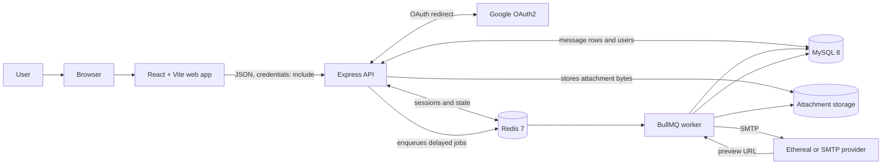

### 2.2 Runtime containers

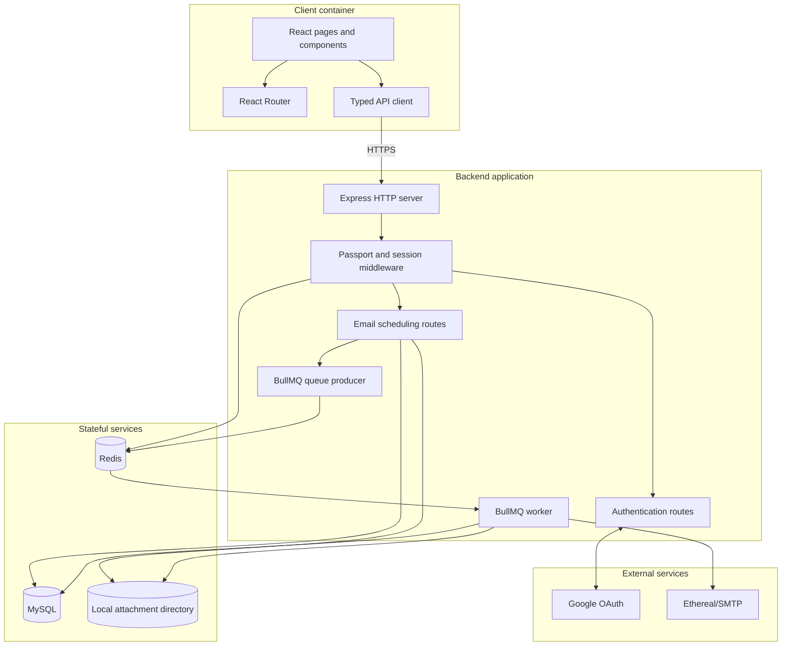

### 2.3 Deployment topology

The included Docker Compose file provides Redis and MySQL. The API, worker, and frontend normally run as application processes on the host or another deployment platform.

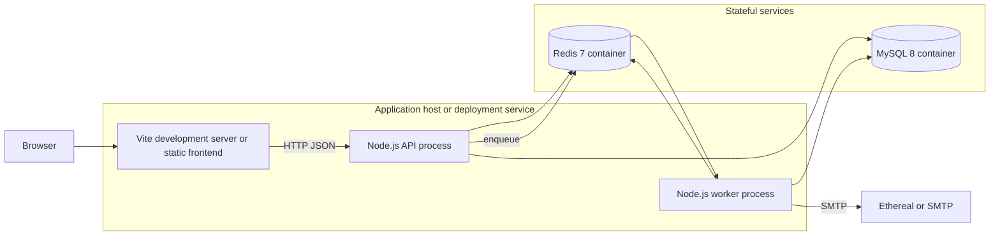

A normal `backend/src/index.ts` process starts the API and an in-process worker. `backend/src/worker-entry.ts` is the standalone worker entry point for intentional process separation.

## 3. Component architecture

### 3.1 Backend components

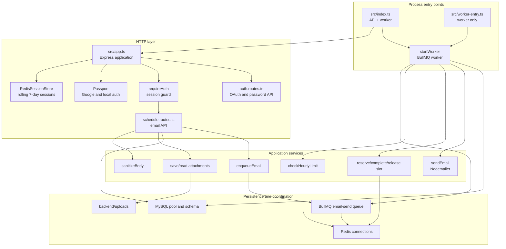

### 3.2 Frontend components

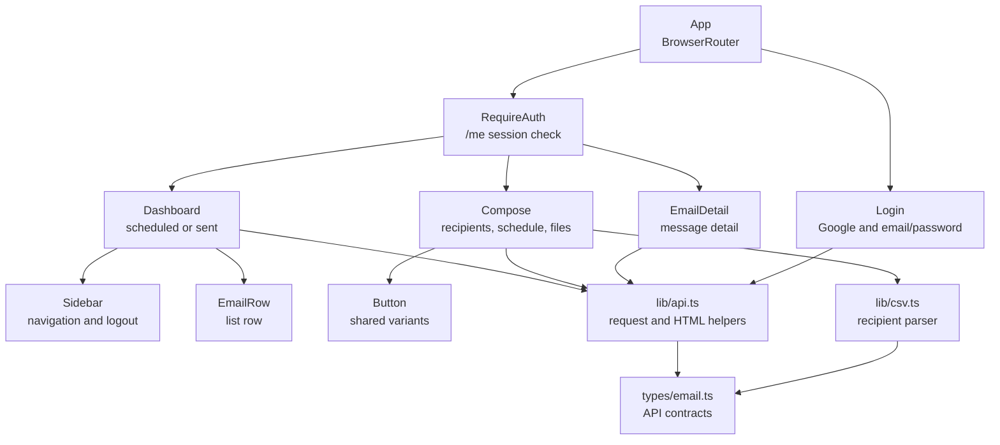

### 3.3 Frontend route map

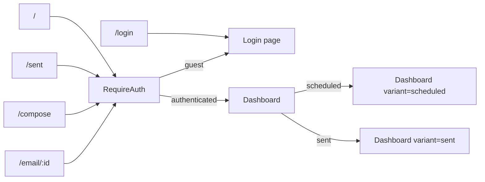

## 4. UML models

### 4.1 Domain and job class diagram

The attachment class is a logical record. The current implementation stores its metadata in the `emails.attachments` JSON column and its bytes in generated files under `backend/uploads`.

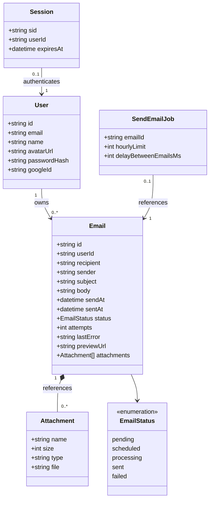

Fields such as `avatarUrl`, `passwordHash`, `googleId`, `sentAt`, `lastError`, and `previewUrl` are nullable in the persistence model.

### 4.2 Email state machine

The scheduling route currently inserts new rows as `scheduled`. The schema also supports `pending` for rows created by earlier versions or manual recovery. A worker can defer a job without changing its logical delivery state.

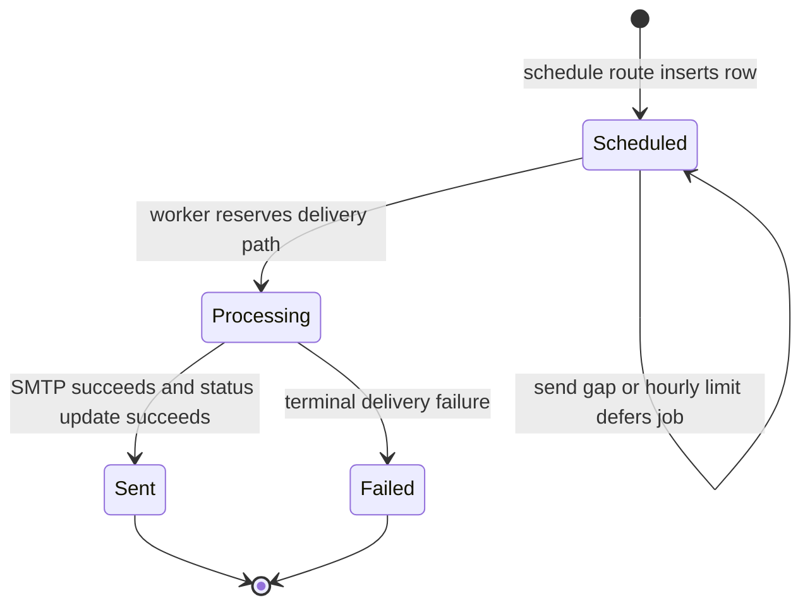

State semantics:

| State | Meaning |
| --- | --- |
| `pending` | Persisted state supported by the schema and included in scheduled reads. |
| `scheduled` | Row is waiting for a delayed BullMQ job. |
| `processing` | Worker has reserved the send path and is preparing SMTP delivery. |
| `sent` | SMTP completed and the database status and preview URL were updated. |
| `failed` | The worker exhausted its retry policy and marked the row terminally failed. |

### 4.3 Persistence entity relationship diagram

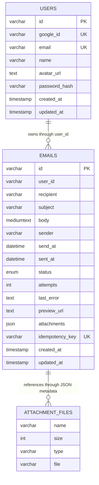

`ATTACHMENT_FILES` is a logical representation, not a separate MySQL table. The database stores the metadata record, while the filesystem stores the bytes. The `emails.user_id` relationship is also logical in the current schema: queries scope access by user id, but the SQL schema does not declare a foreign-key constraint.

## 5. Runtime workflows

### 5.1 Authentication workflow

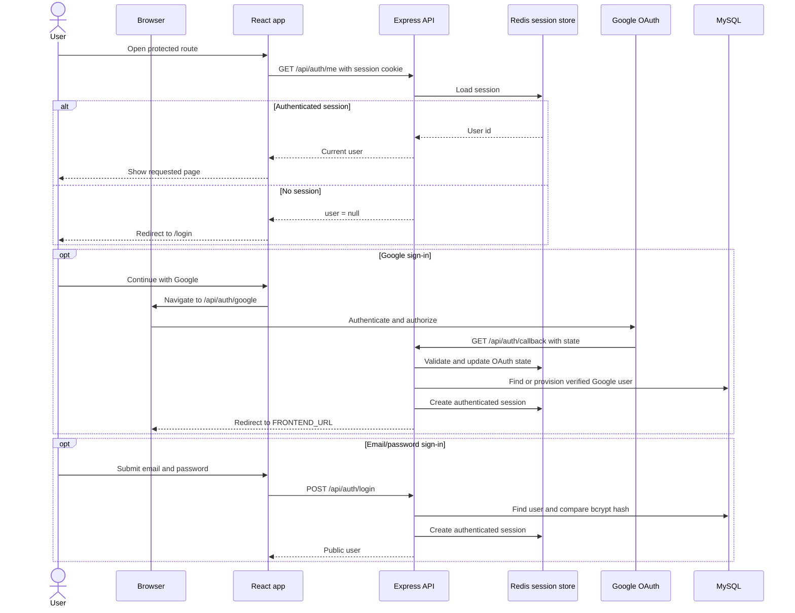

### 5.2 Schedule-a-message workflow

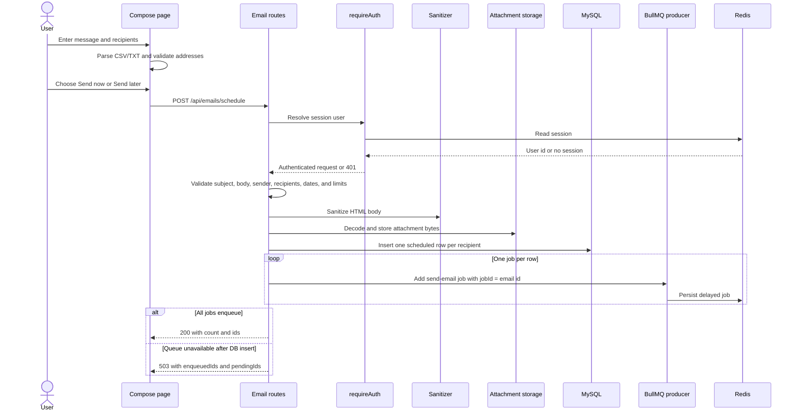

The request limit is 1,000 recipients and 10 attachments. Each attachment is limited to 10 MB. The API accepts a large JSON body because the browser sends attachment bytes as base64.

### 5.3 Worker delivery workflow

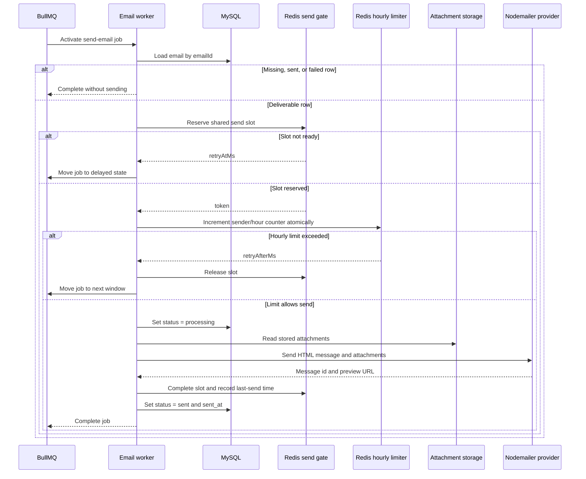

If SMTP or the final database update fails, the worker releases the send slot, records the error, and throws. BullMQ retries the job with exponential backoff. After the configured attempt limit, the worker marks the email as failed.

### 5.4 Attachment workflow

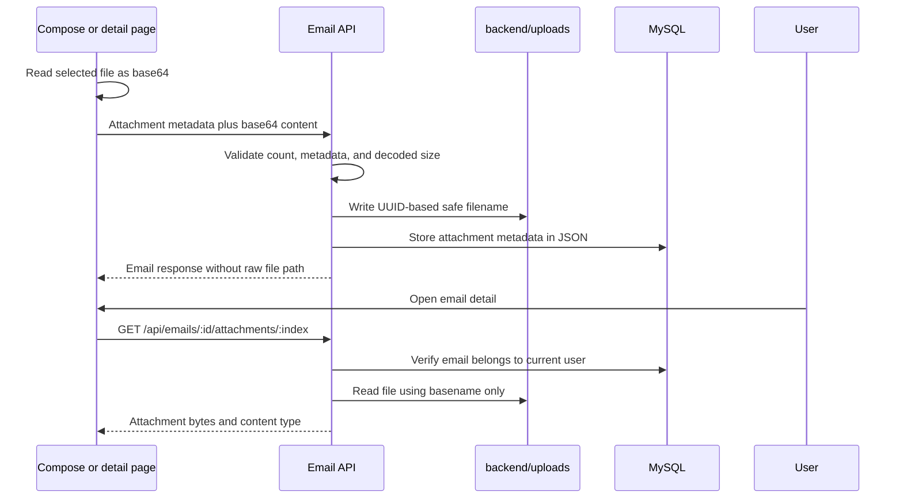

The API response exposes attachment metadata but not the generated disk filename. The client receives bytes only through the authenticated attachment endpoint.

### 5.5 Logout workflow

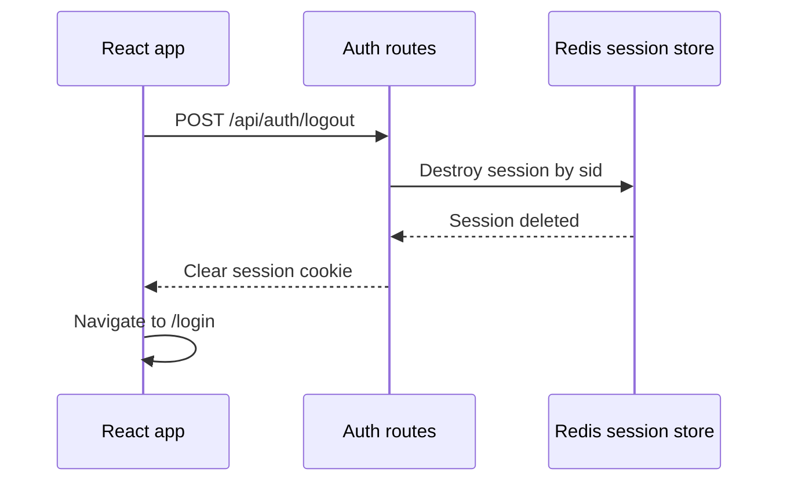

## 6. Data and coordination architecture

### 6.1 MySQL ownership

| Data | Owner | Purpose |
| --- | --- | --- |
| `users` | MySQL | Local and Google identities, profile, password hash, timestamps |
| `emails` | MySQL | Recipient, content, schedule, status, attempts, preview URL, attachment metadata |
| Session data | Redis | Authenticated session state keyed by session id |
| Delayed jobs | Redis/BullMQ | Retryable delivery work keyed by email id |
| Hourly counters | Redis | Per-sender UTC-hour delivery counts |
| Send-gate lease | Redis | Cross-worker SMTP serialization and last-send timestamp |
| Attachment bytes | Filesystem | Generated files under `backend/uploads` |

### 6.2 Redis keyspace

| Key or namespace | Lifetime | Coordination purpose |
| --- | --- | --- |
| `auth:session:<sid>` | Rolling session TTL, default 7 days | Stores authenticated session data. |
| BullMQ `email-send` queue | Until job completion or retention limit | Stores delayed, active, retried, and completed jobs. |
| `rate:<sender>:<UTC-hour>` | One hour | Atomically counts sends for one sender in one UTC hour. |
| `email-send:send-gate:lock` | Short lease | Ensures only one worker enters the SMTP critical section. |
| `email-send:send-gate:last-send` | Persistent until next process/data cleanup | Stores the last successful send timestamp used to enforce the gap. |

### 6.3 Redis atomic operations

The hourly limiter uses a Lua script to combine `INCR` and first-use `EXPIRE`. The send gate uses Lua scripts to reserve, complete, and release a lease using Redis server time. These operations remain coordinated across multiple worker processes.

### 6.4 Storage flow

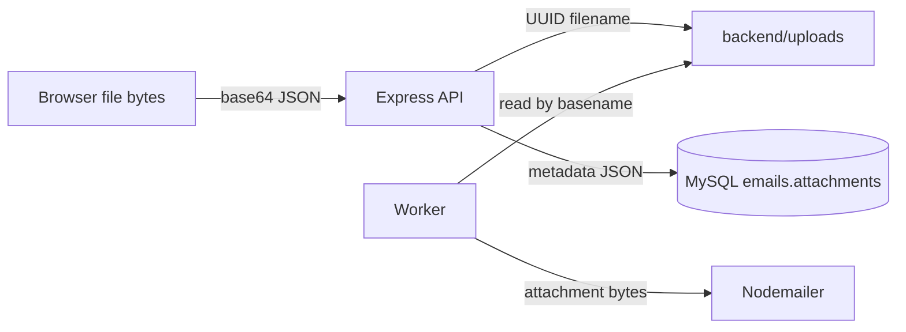

## 7. Security architecture

### 7.1 Trust boundaries

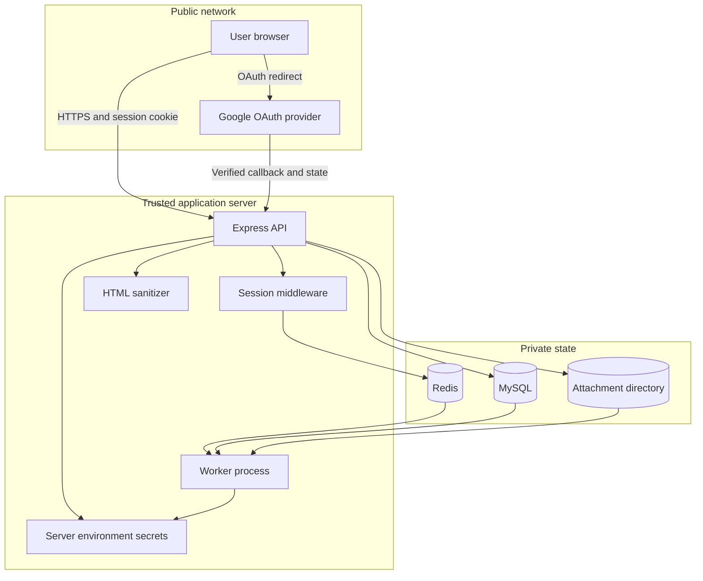

### 7.2 Security controls

| Boundary | Control |
| --- | --- |
| Browser to API | CORS allowlist, JSON content type, credentialed session requests |
| Session cookie | `httpOnly`, `sameSite=lax`, `secure` in production, seven-day rolling lifetime |
| OAuth | Passport Google OAuth with `state: true`; verified email provisioning |
| Passwords | bcrypt hashing and comparison |
| Email routes | `requireAuth` middleware and per-user query scoping |
| Development only | `x-user-id` is accepted only outside production; it must not be enabled in deployed environments |
| HTML content | Server-side allowlist sanitization before persistence and delivery |
| Attachments | Count and decoded-size limits, UUID filenames, basename-only reads |
| Email rendering | Client removes scripts, styles, event attributes, and unsafe URL attributes before HTML rendering |
| Secrets | Google and SMTP credentials stay in backend environment variables |
| Production transport | HTTPS frontend and callback URLs are required by startup validation |

### 7.3 Authentication boundary

`requireAuth` first checks the Passport session. In non-production environments it also accepts an `x-user-id` header as a development convenience. The frontend uses the real session flow and does not send that header.

## 8. API surface

| Method | Endpoint | Authentication | Reads or writes |
| --- | --- | --- | --- |
| `GET` | `/api/health` | None | Liveness response |
| `GET` | `/api/auth/me` | Optional session | Current public user or `null` |
| `GET` | `/api/auth/google` | None | Starts Google OAuth or returns 503 when unconfigured |
| `GET` | `/api/auth/callback` | OAuth state | Provisions user and creates session |
| `POST` | `/api/auth/signup` | None | Creates local user and session |
| `POST` | `/api/auth/login` | None | Verifies credentials and creates session |
| `POST` | `/api/auth/logout` | Optional session | Destroys session and clears cookie |
| `POST` | `/api/emails/schedule` | Required | Validates, stores, and enqueues recipient jobs |
| `GET` | `/api/emails/scheduled` | Required | Reads pending and scheduled rows for current user |
| `GET` | `/api/emails/sent` | Required | Reads sent and failed rows for current user |
| `GET` | `/api/emails/:id` | Required | Reads one owned email |
| `GET` | `/api/emails/:id/attachments/:index` | Required | Streams one owned attachment |

## 9. Reliability and failure semantics

### 9.1 Idempotency

- BullMQ uses `jobId = email.id`, so a duplicate enqueue for the same row is rejected by the queue.
- The worker skips rows already marked `sent` or `failed` before attempting delivery.
- The send gate serializes the SMTP entry point even when worker concurrency is greater than one.
- The schema includes an `idempotency_key` column, but the current schedule route uses the email row id as the operational queue identity.

### 9.2 Retry policy

- Each job receives three attempts.
- Retry backoff is exponential with a 5-second base delay.
- A worker error increments the database attempt counter and stores a bounded error message.
- A terminal worker failure marks the email row as `failed`.
- Rate-limit and send-gap deferrals use BullMQ delayed-job movement rather than dropping the email.

### 9.3 Failure windows

| Failure | Result | Recovery implication |
| --- | --- | --- |
| MySQL insert succeeds, queue add fails | Rows remain scheduled; API returns partial enqueue data | Requeue pending rows through an operational recovery procedure. |
| Redis is flushed | Delayed jobs disappear while MySQL rows remain | Requeue from MySQL after restoring Redis. |
| SMTP succeeds, final DB update fails | Provider may have accepted a message while the row remains non-sent | Retry can produce a duplicate; use provider idempotency or an outbox for stronger guarantees. |
| Attachment is saved, DB insert fails | Generated file may remain without an email row | Add lifecycle cleanup or transactional orphan cleanup. |
| Worker process stops | BullMQ lock recovery makes active jobs available according to BullMQ settings | Redis and MySQL remain the recovery sources of truth. |

### 9.4 Why there is no cron poller

A database polling loop would continuously scan for due rows and would need to reconstruct queue state after a restart. BullMQ stores delayed work in Redis, supports retries and delayed movement, and lets the worker coordinate through the same Redis primitives used for rate limits and send gaps.

## 10. Configuration architecture

| Setting | Scope | Default or behavior |
| --- | --- | --- |
| `PORT` | API process | `4000` |
| `FRONTEND_URL` | CORS and OAuth redirect | `http://localhost:5173` |
| `DB_HOST`, `DB_PORT` | MySQL pool | `localhost`, `3306` |
| `DB_USER`, `DB_PASSWORD`, `DB_NAME` | MySQL pool | Backend environment |
| `REDIS_URL` | Queue, sessions, limits, gate | `redis://localhost:6380` in the example environment |
| `WORKER_CONCURRENCY` | Worker | `5` |
| `MAX_EMAILS_PER_HOUR` | Default hourly limit | `50` |
| `MIN_SEND_DELAY_MS` | Worker limiter and send-gap floor | `1000` |
| `SESSION_SECRET` | Session signing | Random fallback in development; required in production |
| `GOOGLE_CLIENT_ID` | OAuth | Empty by default |
| `GOOGLE_CLIENT_SECRET` | OAuth | Empty by default |
| `GOOGLE_CALLBACK_URL` | OAuth | Local callback in the example environment |
| `ETHEREAL_*` | SMTP | Auto-created test account when credentials are blank |
| `VITE_API_URL` | Browser API client | `http://localhost:4000` |

## 11. Source map

### Backend

| Area | Primary files |
| --- | --- |
| Process startup | `backend/src/index.ts`, `backend/src/worker-entry.ts` |
| HTTP composition | `backend/src/app.ts` |
| Authentication | `backend/src/api/auth.routes.ts`, `backend/src/middleware/requireAuth.ts` |
| Email API | `backend/src/api/schedule.routes.ts` |
| Queue | `backend/src/queue/queue.ts`, `backend/src/queue/worker.ts` |
| Send coordination | `backend/src/queue/sendGate.ts` |
| Hourly limits | `backend/src/rateLimiter/hourlyLimiter.ts` |
| Database | `backend/src/db/client.ts`, `backend/src/db/migrate.ts`, `backend/src/db/schema.sql` |
| Sessions | `backend/src/session/redisSessionStore.ts` |
| SMTP | `backend/src/lib/mailer.ts` |
| Attachments | `backend/src/lib/attachments.ts` |
| Content safety | `backend/src/lib/sanitize.ts` |
| Configuration | `backend/src/config/env.ts`, `backend/src/config/redis.ts` |

### Frontend

| Area | Primary files |
| --- | --- |
| Routes and auth guard | `frontend/src/App.tsx` |
| Login | `frontend/src/pages/Login.tsx` |
| Dashboard | `frontend/src/pages/Dashboard.tsx` |
| Compose | `frontend/src/pages/Compose.tsx` |
| Email detail | `frontend/src/pages/EmailDetail.tsx` |
| Layout | `frontend/src/components/layout/Sidebar.tsx` |
| Email list row | `frontend/src/components/email/EmailRow.tsx` |
| Shared button | `frontend/src/components/ui/Button.tsx` |
| API boundary | `frontend/src/lib/api.ts` |
| Recipient parsing | `frontend/src/lib/csv.ts` |
| Shared types | `frontend/src/types/email.ts` |
| Build configuration | `frontend/vite.config.ts`, `frontend/package.json` |

## 12. Testing and operations

### Test layers

| Layer | Location or command | What it verifies |
| --- | --- | --- |
| Sanitization | `backend/src/__tests__/sanitize.test.ts` | HTML allowlist and unsafe content removal |
| Authentication | `backend/src/__tests__/requireAuth.test.ts` | Session and development identity behavior |
| Mailer | `backend/src/__tests__/mailer.test.ts` | Mailer behavior and test-address handling |
| Send gap | `backend/src/__tests__/sendDelay.test.ts` | Effective delay calculation |
| Send gate | `backend/src/__tests__/sendGate.integration.test.ts` | Cross-worker slot coordination through Redis |
| Hourly limiter | `backend/src/__tests__/rateLimiter.test.ts` | Buckets, limits, and sender isolation |
| Hourly integration | `backend/src/__tests__/hourlyLimiter.integration.test.ts` | Concurrent Redis behavior |
| Idempotency | `backend/src/__tests__/idempotency.test.ts` | Worker sent-state guard |
| End-to-end helper | `backend/src/scripts/test-e2e.ts` | Local scheduling and delivery flow |
| Load helper | `backend/src/scripts/load-test-1000.ts` | Bulk recipient and queue behavior |

### Commands

Backend:

```bash
npm run dev
npm run dev:worker
npm run migrate
npm run build
npm test
```

Frontend:

```bash
npm run dev
npm run build
npm run lint
npm run preview
```

The backend integration tests require a reachable Redis instance. The current frontend package has no browser test script; the backend suite is the primary automated test suite.

## 13. Architectural decisions and trade-offs

| Decision | Benefit | Trade-off |
| --- | --- | --- |
| MySQL for message state | Queryable history and ownership filtering | Queue and database writes are separate operations |
| BullMQ delayed jobs | Durable scheduling, retries, and delayed movement | Redis availability is required for delivery |
| Redis Lua coordination | Atomic behavior across workers | Redis becomes a critical runtime dependency |
| Database row id as job id | Natural duplicate-enqueue protection | A row id must remain stable for the life of the message |
| Ethereal for development | Real SMTP flow without real recipient delivery | Preview URLs are development-oriented and not a production mailbox |
| Google plus local auth | Supports OAuth deployment and local development | Two account-provisioning paths must remain consistent |
| Server-side attachment storage | Keeps raw paths out of the client | Requires filesystem lifecycle and capacity management |
| SPA frontend routing | Simple navigation and static hosting | The static host must provide an `index.html` fallback |
